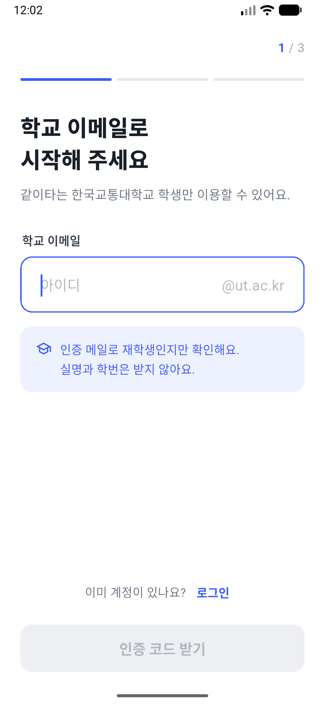
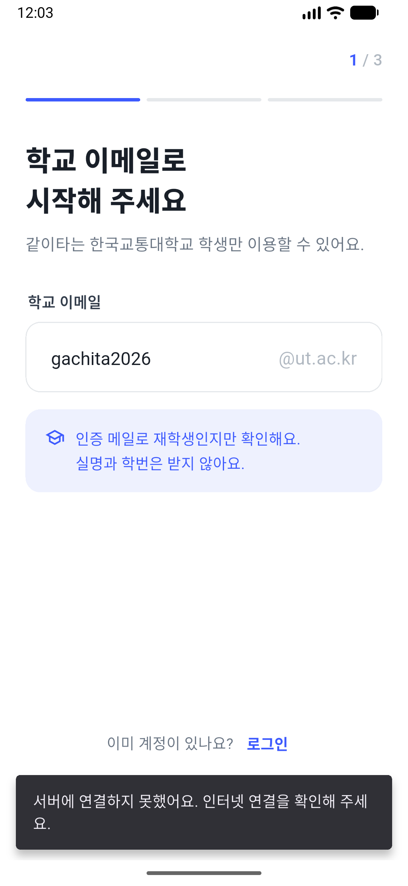

# 같이타 (GachiTa) — F-01 회원가입 · 로그인

팀 유니링크 캡스톤디자인. 한국교통대학교 학생 택시 동행 앱 **같이타**의 회원가입 · 로그인(F-01) 모듈입니다.
Flutter + Supabase, 팀 공유본(F-07 · F-08 · F-10)과 같은 DB 구조를 사용합니다.

| 1단계 학교 이메일 | 서버 오류 안내 |
|---|---|
|  |  |

## 기능
- 학교 메일(`학번@a.ut.ac.kr`)로 **6자리 인증 코드** 받기 → 코드 입력 → 닉네임 · 비밀번호 · 약관 동의
- 학교 메일이 아니면 서버(DB 트리거)에서 가입 차단
- 닉네임 실시간 중복 확인, 비밀번호 규칙(8자 이상 · 영문+숫자) 표시
- 이메일 + 비밀번호 로그인, 코드 방식 비밀번호 재설정
- 가입 도중 앱을 꺼도 다시 열면 남은 단계부터 이어서 진행

## 폴더 구조
```
lib/features/auth/        ← 팀 공유본에 그대로 복사하는 F-01 모듈
  ├─ signup_flow.dart        SignupFlow(가입 시작 화면), SignupCompletionGate(3단계 미완료 사용자 처리)
  ├─ auth_service.dart       Supabase 호출 + 오류 문구
  ├─ auth_config.dart        학교 도메인, 코드 길이/유효시간, 재발송 대기 등 설정값
  ├─ screens/                1·2·3단계, 로그인, 비밀번호 재설정, 약관
  └─ widgets/                공통 입력칸, 6칸 코드 입력, 단계 화면 틀
lib/main.dart             ← F-01 단독 실행용 (팀 공유본에서는 사용 안 함)
supabase/migrations/      ← 팀 공통 기반 · F-07/08/10 · F-01 SQL
docs/F01_팀연동가이드.md   ← Supabase 대시보드 설정 + 팀 공유본에 합치는 방법
```

## 실행
```powershell
Copy-Item config/development.example.json config/development.json   # 처음 한 번
# config/development.json 에 SUPABASE_URL, SUPABASE_PUBLISHABLE_KEY 입력
flutter pub get
flutter run --dart-define-from-file=config/development.json
```
- `config/development.json` 은 Git 에 올라가지 않습니다. 값은 팀 채팅으로 공유해 주세요.
- Supabase 쪽 설정(코드 길이 6자리, SMTP, 메일 템플릿)은 **[연동 가이드](docs/F01_팀연동가이드.md)** 를 꼭 따라 주세요.

## 팀 공유본에 합치기
`lib/features/auth/` 폴더 복사 후 `main.dart`, `session_gate.dart` 두 곳만 수정하면 됩니다.
자세한 코드는 [연동 가이드 3장](docs/F01_팀연동가이드.md#3-팀-공유본에-합치기)에 있습니다.
